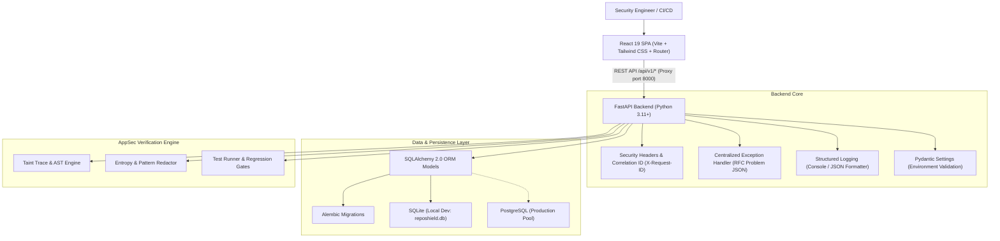

# RepoShield AI - Architecture Overview

**RepoShield AI** is an enterprise application security (AppSec) platform engineered by **Xerova Digital Solutions**. It detects source-code vulnerabilities and verifies proposed security fixes using evidence from static/dynamic scanners and automated sandbox test gates.

---

## 1. High-Level Architecture

---

## 2. Technology Stack

### Frontend
- **Framework**: React 19 with TypeScript
- **Build Tool**: Vite 6
- **Routing**: React Router (DOM v7) with state synchronization
- **Styling**: Tailwind CSS v4 design token system with Xerova dark/light mode palette
- **Component Primitives**: Lucide Icons, Material Symbols, Motion micro-interactions
- **Testing**: Vitest + React Testing Library + JSDOM

### Backend
- **Framework**: FastAPI (ASGI with Uvicorn)
- **Data Validation**: Pydantic v2 with `BaseSettings`
- **Database ORM**: SQLAlchemy 2.0 (Declarative Base, UUID keys, UTC timestamps)
- **Database Migrations**: Alembic 1.13+
- **Security Middleware**: OWASP-aligned response headers (`nosniff`, `DENY`, `X-XSS-Protection`, `X-Request-ID`)
- **Testing**: Pytest 8+ with HTTPX Async/Sync `TestClient`

---

## 3. Database Strategy

| Environment | Database Engine | Dialect / Driver | Configuration |
|---|---|---|---|
| **Development** | SQLite 3 | `sqlite:///./reposhield.db` | `check_same_thread=False` |
| **Testing** | SQLite in-memory / file | `sqlite:///./test_reposhield.db` | Auto-created & destroyed per session |
| **Production** | PostgreSQL 15+ | `postgresql+psycopg://...` | Connection pooling (`pool_size=10, max_overflow=20`) |

---

## 4. Security Principles

1. **Zero Hardcoded Secrets**: Production credentials are never checked in. Safe placeholders exist in `.env.example`.
2. **Untrusted Input**: All code comments and AST excerpts are treated as untrusted to defend against prompt injection.
3. **Secret Redaction**: Automated redaction of AWS keys, JWTs, and API tokens occurs prior to any model ingestion.
4. **Observable Telemetry**: All requests receive a unique `X-Request-ID` correlated through middleware and structured logs.
