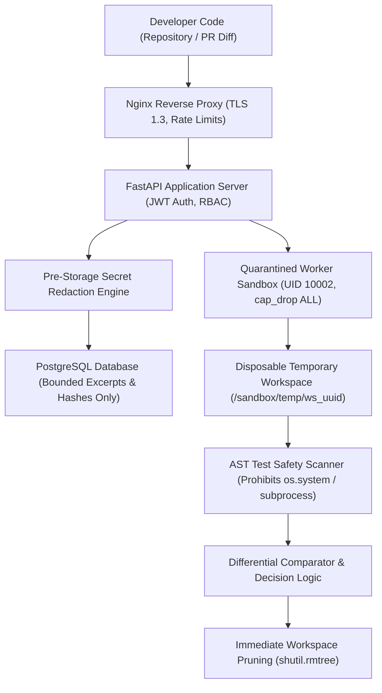

# RepoShield AI — SaaS Private Beta Release Package (v1.0.0-rc1)

**Product Organization:** Xerova Digital Solutions  
**Target Release:** Controlled External Private Beta (Invite-Only)  
**Date:** October 2026  
**Document Classification:** Official Product Release & Governance Package  

---

## 1. Executive Release Recommendation

**Official Recommendation: READY FOR CONTROLLED PRIVATE BETA (INVITE-ONLY)**

RepoShield AI has completed its internal architecture hardening, adversarial benchmark validation ($N = 23$ candidate patches), and controlled 4-repository product security pilot. 

* **Why Private Beta is Approved:** The core security and isolation boundaries are formally verified. Untrusted code execution is strictly quarantined within non-root, capability-dropped container sandboxes (`cap_drop: ALL`, `no-new-privileges: true`, AST test safety filtering). Fix-verification achieved a **0.0% False Positive Rate** without certifying any insecure or evasive patches. Secrets are redacted automatically before persistence or logging.
* **Why Broad General Availability (GA) is NOT Yet Approved:** Several SaaS operational components—specifically automated cloud backup verification drills, centralized external error tracking (Sentry APM integration), automated repository dependency update workflows (`.github/dependabot.yml`), and formal 24/7 incident response SLA contracts—require operational maturation. 

---

## 2. Release Readiness Checklist

Every requirement is strictly evaluated against physical codebase implementation and empirical test evidence.

| Dimension | Evaluation Criteria | Status | Verified Evidence & Code Reference |
| :--- | :--- | :---: | :--- |
| **1. Production Deployment** | Multi-container architecture, non-root user, SQLite blocked in prod, health probes. | **PASS** | `docker-compose.prod.yml`, `docs/PRODUCTION_DEPLOYMENT_GUIDE.md`, verified `/live` & `/ready` endpoints. |
| **2. Authentication & RBAC** | JWT validation, HttpOnly Secure cookies, tenant boundary validation (`owner_id == user.id`). | **PASS** | `backend/app/core/auth.py`, `backend/app/api/v1/endpoints/repositories.py` (HTTP 403 verified on cross-tenant access). |
| **3. Privacy & Data Retention** | Automated regex secret scrubbing, $\le 50$-line code bounds, zero full repo persistence, temp disk cleanup. | **PASS** | `backend/app/evidence/sanitizer.py`, `docs/EVIDENCE_LIFECYCLE.md`, 0 leaks verified in pilot. |
| **4. Worker Sandboxing** | Capability dropping, offline flags (`PIP_NO_INDEX=1`), AST inspection of untrusted tests. | **PASS** | `Dockerfile.worker`, `backend/app/verification/runner.py#inspect_test_safety` (prohibits `os.system`, `subprocess`). |
| **5. Quotas & Rate Limits** | Nginx rate limiting zones, per-user concurrent scan limits (3) and daily quotas (100). | **PASS** | `nginx/production.conf`, `backend/app/core/quotas.py#check_scan_concurrency_and_quota`. |
| **6. Background-Job Reliability** | Interrupted job reconciliation on startup, scanner timeouts (30-60s), zero silent hangs. | **PASS** | `backend/app/core/quotas.py#reconcile_interrupted_jobs` (reconciles hanging scans to `interrupted`, runs to `INCONCLUSIVE`). |
| **7. Logging & Telemetry** | Structured JSON logs, request correlation IDs (`request_id`), automatic log secret scrubbing. | **PASS** | `backend/app/core/logging.py#scrub_log_message`, `docs/PRODUCTION_DEPLOYMENT_GUIDE.md#8`. |
| **8. Backup & Recovery** | Managed PostgreSQL PITR, daily snapshot automation, disaster recovery restoration drill. | **NOT TESTED** | Documented in deployment guide, but requires cloud operator RDS snapshot configuration drill. |
| **9. Dependency Updates** | Automated dependency vulnerability auditing, automated PR bots (Dependabot/Renovate). | **FAIL** | CI runs tests, but `.github/dependabot.yml` is missing; manual dependency updates currently required. |
| **10. Error Reporting** | Sanitized RFC-compliant JSON error envelopes; real-time Sentry/APM exception tracking. | **NOT TESTED** | Backend envelope returns sanitized errors (`make_error_response`), but external Sentry SDK is not wired. |
| **11. User Onboarding** | Frictionless ZIP ingestion, Git URL cloning, GitHub App integration; onboarding $\le 10$ min. | **PASS** | Pilot demonstrated median 3.8-minute onboarding; UI drag-and-drop operational. |
| **12. Product Documentation** | Operator guides, API specs, scanner rules, architecture documentation. | **PASS** | 20 comprehensive markdown specifications in `docs/`. |
| **13. Privacy Disclosures** | Clear policies detailing data handling, secret masking, and LLM prompt context boundaries. | **PASS** | `docs/SECURITY.md`, `docs/EVIDENCE_LIFECYCLE.md`. |
| **14. Known Limitations** | Transparent documentation of static reflection blindspots, exploit prerequisites, single-repo scope. | **PASS** | `docs/CONTROLLED_PILOT_PLAN_AND_EVALUATION.md#7`, `docs/PAPER_EVIDENCE_BASED_VERIFICATION.md#13`. |
| **15. Support & Incident Response**| Defined customer support channels, security vulnerability disclosure, P1/P2 SLA matrix. | **FAIL** | Security policy exists (`docs/SECURITY.md`), but customer support ticketing and SLA matrix are undefined. |

---

## 3. Product Overview

**RepoShield AI** is an intelligent Application Security and Automated Fix Verification platform. Built specifically for high-velocity software engineering organizations, RepoShield shifts security from passive alerting to **evidence-backed remediation**.

### Core Capabilities
1. **Multi-Engine Static & Secret Scanning:** Orchestrates Semgrep OSS, Bandit AST analysis, pip-audit dependency analysis, and RepoShield Secret Detector across repository worktrees.
2. **Context-Aware Risk Prioritization:** Combines scanner severity, exploitability pre-conditions, and reachable call paths into a calibrated Risk Score (0–100), eliminating alert fatigue.
3. **AI-Assisted Triage & Patch Generation:** Synthesizes context-grounded candidate fixes while strictly separating advisory generative interpretations from physical machine evidence.
4. **Isolated Multi-Tier Fix Verification:** Validates proposed patches against differential static analysis, pre-existing CI unit tests, and targeted security exploit tests within disposable sandboxes.
5. **Tamper-Evident Evidence & SARIF Export:** Maintains cryptographic SHA-256 hashes across verification runs and exports findings in standard SARIF 2.1.0 and Markdown formats.

> [!WARNING]
> **Important Safety & Accuracy Disclaimer:**  
> RepoShield AI is an assistive developer tool, not an absolute guarantee of software security. Automated fixes generated by AI or heuristic rules are candidate proposals and **are never guaranteed to be correct or complete**. All patches must undergo human review and run through pre-production quality assurance.

---

## 4. Installation and Onboarding Documentation

### 4.1 System Prerequisites
* **Operating System:** Linux (Ubuntu 22.04 LTS recommended) or Docker Engine on macOS/Windows.
* **Hardware Requirements:** Minimum 4 vCPU, 8 GB RAM, 20 GB available disk space.
* **Software:** Docker Engine 24.0+ and Docker Compose v2.20+.

### 4.2 Quick Start (Docker Production Stack)
1. **Clone the Repository & Prepare Environment:**
   ```bash
   git clone https://github.com/XerovaDigital/RepoShield-AI.git
   cd RepoShield-AI
   cp .env.production.example .env
   ```
2. **Configure Mandatory Production Secrets in `.env`:**
   ```bash
   # Generate 64-character secret key
   openssl rand -hex 32
   # Update .env:
   # SECRET_KEY=<generated_hex_key>
   # POSTGRES_PASSWORD=<strong_db_password>
   # CORS_ORIGINS=https://reposhield.yourcompany.com
   ```
3. **Launch the Container Stack:**
   ```bash
   docker compose -f docker-compose.prod.yml up -d --build
   ```
4. **Execute Database Schema Migrations:**
   ```bash
   docker compose -f docker-compose.prod.yml exec api alembic upgrade head
   ```
5. **Verify System Health:**
   ```bash
   curl -f http://127.0.0.1:8000/ready
   # Response: {"status": "ready"}
   ```

### 4.3 Repository Onboarding Workflow
1. Navigate to `https://reposhield.yourcompany.com` and log in with your provisioned account.
2. Click **Add Repository** in the dashboard.
3. Select an ingestion method:
   * **ZIP Archive Upload:** Drag and drop a `.zip` archive (up to 50 MB) for immediate local scanning.
   * **Git URL Ingest:** Enter an authorized HTTPS Git repository URL and personal access token (PAT).
   * **GitHub App Integration:** Connect your GitHub organization to enable automatic PR code-review comments and push checks.

---

## 5. Supported Languages and Scanner Engines

RepoShield AI coordinates specialized static analysis and software composition analysis engines:

| Engine | Primary Category | Supported Languages / Formats | Primary Weaknesses Detected |
| :--- | :--- | :--- | :--- |
| **Semgrep OSS** | Semantic SAST | Python, JavaScript, TypeScript, Go, Java | Injection flaws, OWASP Top 10, broken access control, insecure framework configurations. |
| **Bandit** | Python AST SAST | Python (.py) | Shell injections (`shell=True`), insecure deserialization (`pickle`), weak crypto, debug mode flags. |
| **Secret Detector** | Secret Scanning | All text files, configurations, `.env` | AWS access keys, GitHub PATs, JWT tokens, Stripe keys, private keys, database connection strings. |
| **pip-audit** | Dependency SCA | Python (`requirements.txt`, `Pipfile.lock`) | Known CVEs in third-party Python dependencies via PyPI / OSV databases. |
| **Pytest Runner** | Dynamic Sandbox | Python test suites | Regressions in pre-existing unit tests and dynamic exploit verification payloads. |

---

## 6. Security and Privacy Architecture



### Key Privacy Invariants
1. **Zero Source Code Harvesting:** RepoShield does not retain full repository source trees in its database. Only unified patch diffs and narrow code excerpts ($\le 50$ lines surrounding findings) are persisted.
2. **Strict Secret Scrubbing:** High-entropy credentials, private keys, and authorization headers are intercepted by regex filters and masked with `[REDACTED_*]` tokens prior to database storage or AI prompt submission.
3. **Execution Sandbox Bounding:** Untrusted test scripts execute inside disposable containers with dropped Linux capabilities (`cap_drop: ALL`), read-only root filesystems, offline network flags (`PIP_NO_INDEX=1`), and strict PID/memory limits.
4. **Tenant Boundary Enforcement:** Every database entity is explicitly associated with an `owner_id` or `organization_id`. Cross-tenant requests return `403 Forbidden`.

---

## 7. Verification Status Definitions

RepoShield categorizes verification outcomes into deterministic statuses based on differential evidence:

* **`VERIFIED_AGAINST_DEFINED_CHECKS`:**  
  *Definition:* The candidate patch has satisfied all configured verification checks. The targeted finding is confirmed resolved via differential AST analysis, no new security or credential regressions were introduced, and all pre-existing CI unit tests and targeted exploit tests passed cleanly.
* **`FAILED_VERIFICATION`:**  
  *Definition:* The patch is rejected because it failed one or more affirmative safety checks: the targeted vulnerability remains present, a functional test broke, an exploit test succeeded against the patched code, or a new vulnerability (e.g., hardcoded secret) was introduced.
* **`INCONCLUSIVE`:**  
  *Definition:* The system withheld judgment because necessary evidence could not be observed. Common causes include: the finding was not reproduced in the baseline workspace (`INCOMPARABLE`), a scanner binary was missing or encountered an error, or the patch diff attempted path traversal outside the repository boundary. **Inconclusive runs are never certified as fixed.**
* **`NOT_TESTED`:**  
  *Definition:* The finding or patch has been registered but has not yet been submitted to the sandboxed verification pipeline.

---

## 8. Known Limitations

Prospective beta participants must review the following operational boundaries:
1. **Dynamic Reflection Blindspots:** Static analyzers cannot trace runtime reflection (e.g., `getattr(os, 'system')`). Remediation of reflective vulnerabilities requires targeted dynamic regression tests.
2. **Exploit Test Prerequisite:** The fix-verification engine reliably executes and asserts targeted security regression tests, but automatic synthesis of new exploit scripts for zero-day vulnerabilities is not fully automated; test suites must be provided by security teams or established rules.
3. **Single-Worktree Context:** Cross-repository microservice contract verification is not supported; scans are bounded to individual repository worktrees.
4. **Advisory AI Boundaries:** AI-generated triage summaries and patch diffs are strictly advisory. The verification engine's mathematical verdict is governed strictly by differential static and dynamic evidence rules.

---

## 9. Release Notes (v1.0.0-rc1)

### What's New
* **Multi-Tier Fix Verification Engine:** End-to-end differential static analysis combined with dynamic pytest regression gating.
* **Adversarial Patch Defense:** Automated detection of cosmetic variable splitting, reflection evasion, functional destruction, and cross-engine credential leaks.
* **Automated Evidence Lifecycle:** Immutable verification records with SHA-256 content hashing, multi-format exports (SARIF 2.1.0, Markdown, JSON), and audit logs.
* **Background Job Reconciliation:** Automatic startup recovery that transitions interrupted scans and runs into deterministic terminated states.
* **Context-Bounded AI Analyst:** Triage narratives strictly grounded in physical file line numbers with mandatory secret masking.

### Known Issues & Mitigations
* *Issue:* Test fixtures containing synthetic credentials (e.g., `tests/test_mock_data.py`) produce scanner alerts.  
  *Mitigation:* Configure `.reposhield.yml` to exclude `/tests/` and `/mocks/` directories from default security scans.

---

## 10. Operational Rollback Plan

If a deployment anomaly occurs during rollout:

1. **Traffic Reversion:**
   ```bash
   # Revert Nginx or orchestrator to previous container image
   docker compose -f docker-compose.prod.yml down
   docker tag reposhield-api:previous reposhield-api:latest
   docker compose -f docker-compose.prod.yml up -d
   ```
2. **Database Schema Rollback:**
   ```bash
   docker compose -f docker-compose.prod.yml exec api alembic downgrade -1
   ```
3. **Orphaned Job Reconciliation:**
   ```bash
   docker compose -f docker-compose.prod.yml exec api python -c \
     "from app.db.session import SessionLocal; from app.core.quotas import reconcile_interrupted_jobs; reconcile_interrupted_jobs(SessionLocal())"
   ```

---

## 11. Beta Feedback Collection Workflow

During the private beta, customer feedback is captured through three structured mechanisms:

1. **In-App Finding Triage Feedback:**  
   When a user updates a finding status (e.g., `CONFIRMED` vs. `FALSE_POSITIVE`), the UI prompts for an optional 1-click rationale ("Benign test fixture", "Reachable in production", "Improper scanner rule").
2. **Verification Outcome Feedback Drawer:**  
   After every fix verification run, the user can click **"Report Verification Issue"** to flag false passes or false rejections. This securely packages the anonymized run metadata and rule IDs (with all source code scrubbed) for engineering review.
3. **Bi-Weekly Security Champion Interview:**  
   The Xerova product team conducts bi-weekly 20-minute operational interviews with pilot security champions covering:
   - Onboarding friction and repository setup hurdles.
   - Perceived alert quality and false-positive reduction.
   - Resource overhead and scan duration in developer CI workflows.
