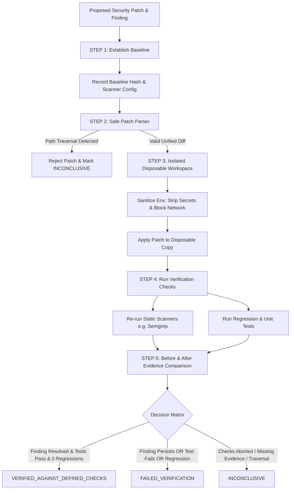

# RepoShield AI — Fix Verification Engine

## Core Objective

The **Fix Verification Engine** determines whether a proposed security patch passes a defined set of security checks and whether the available evidence supports the conclusion that the original security finding has been addressed.

> [!CAUTION]
> **Core Verification Invariants & Security Guardrails:**
> - Do not equate a successful build, passing unit tests, or an AI-generated explanation with proof that a vulnerability has been eliminated.
> - A scanner finding disappearing does not prove that the vulnerability is impossible.
> - Passing tests do not prove complete security.
> - A patch may change code paths or trigger a different rule without fixing the underlying issue.
> - If no relevant regression test exists, explicitly record that limitation.
> - **Never claim universal security or mathematically proven correctness.**

---

## Architecture Overview



---

## Implementation Steps

### STEP 1 — Establish the Baseline
1. **Preserve Original Finding**: The original `SecurityFinding` record is referenced immutably by `finding_id`.
2. **Cryptographic Content Hashing**: Computes SHA-256 of the baseline repository tree (`calculate_directory_hash`) across source files.
3. **Record Scanner Metadata**: Scanner name, version, category, and configuration parameters are captured.
4. **Identify Context**: Locates affected source file path, vulnerable line number, and rule identifier.

### STEP 2 — Validate the Proposed Patch
Implemented in [backend/app/verification/patch_parser.py](file:///c:/PROJECTS/dhina%20projects/RepoShield%20AI/backend/app/verification/patch_parser.py):
1. **Unified Diff Parsing**: Strictly parses `diff --git`, `--- a/...`, `+++ b/...`, and `@@ -l,s +l,s @@` hunk blocks.
2. **Path Sanitization**:
   - Rejects `..` parent directory traversal attempts.
   - Rejects absolute paths (`/etc/passwd`, `C:\Windows\...`).
   - Rejects Windows drive letters and null bytes (`\0`).
   - Verifies all targets normalize strictly within the repository workspace.
3. **Dry-Run Inspection**: Computes exact modified files, added lines count, deleted lines count, and target line ranges before any modifications are attempted.
4. **No Direct Production Application**: Proposed patches are never applied directly to production or unreviewed source repositories.

### STEP 3 — Prepare an Isolated Verification Workspace
Implemented in [backend/app/verification/workspace.py](file:///c:/PROJECTS/dhina%20projects/RepoShield%20AI/backend/app/verification/workspace.py) and [backend/app/verification/patch_applier.py](file:///c:/PROJECTS/dhina%20projects/RepoShield%20AI/backend/app/verification/patch_applier.py):
1. **Disposable Worktree**: Copies the target repository into an ephemeral temporary directory (`tempfile.mkdtemp`).
2. **Context-Verified Patch Application**: Safely modifies source files inside the disposable worktree with hunk context matching.
3. **Sanitized Environment**:
   - Strips application secrets (`GEMINI_API_KEY`, `SECRET_KEY`, `JWT_SECRET`, tokens, passwords) from runner process environment.
   - Disables unnecessary network access during testing by setting `PIP_NO_INDEX=1` and `NO_PROXY=*`.
4. **Resource Bounds**: Enforces execution timeouts on subprocess calls (30-60s timeout).
5. **Deterministic Cleanup**: The disposable workspace is wiped completely in a `finally:` block.

### STEP 4 — Run Verification Checks & Regression Analysis
Implemented in [backend/app/verification/runner.py](file:///c:/PROJECTS/dhina%20projects/RepoShield%20AI/backend/app/verification/runner.py) and [backend/app/verification/comparator.py](file:///c:/PROJECTS/dhina%20projects/RepoShield%20AI/backend/app/verification/comparator.py):

#### 1. Static Analysis Before-and-After Comparison
Re-executes configured scanners (`Semgrep`, `Bandit`, `pip-audit`, `Gitleaks`) on the patched worktree under the exact same configuration as baseline.

#### 2. Six-Status Finding Classification Taxonomy & Exact Rules
Each finding observed across baseline and patched revisions is classified into one of six mutually exclusive categories:

| Classification | Exact Rule Definition |
| :--- | :--- |
| **`RESOLVED_BY_DEFINED_CHECKS`** | The targeted baseline finding was reproduced in the baseline workspace under the configured scanner rules and is no longer reported in the patched workspace under the same scanner configuration. |
| **`STILL_PRESENT`** | The target finding remains detected by the scanner in the patched workspace under the same rule and file path with overlapping or identical sink location. |
| **`UNCHANGED`** | Non-target pre-existing findings in unmodified files or unaffected sections that remain present in both baseline and patched workspaces without alteration. |
| **`NEW`** | A finding detected in the patched workspace that did not exist in the baseline workspace, representing a newly introduced security defect or regression. |
| **`POTENTIALLY_REGRESSED`** | A baseline finding in a modified file whose location, sink, or severity shifted without being completely resolved, or a partial fix where an associated vulnerability pattern remains detectable in the modified hunk. |
| **`INCOMPARABLE`** | Static comparison could not be completed reliably because the scanner errored/timed out, the scanner configuration differed between runs, or the baseline finding was never reproduced by the scanner in the baseline workspace. |

#### 3. Test Suite Regression Analysis
1. **Baseline Test Execution**: Existing tests are run prior to patch application to record baseline pass/fail status.
2. **Patched Test Execution**: Existing tests and targeted security regression tests run in the isolated sandbox.
3. **Regression Detection**: If any test suite passed in baseline but fails in patched, a blocking `test_regressions` item is logged.

### STEP 5 — Produce an Evidence-Based Result & Decision Axioms
The engine evaluates the collected evidence and assigns one of five mutually exclusive verification statuses without hiding uncertainty:

| Status | Definition |
| :--- | :--- |
| `NOT_TESTED` | No verification checks have been completed. |
| `RUNNING` | Verification run is actively executing in sandbox runner. |
| `VERIFIED_AGAINST_DEFINED_CHECKS` | All required checks passed, target finding was `RESOLVED_BY_DEFINED_CHECKS`, no `NEW` or `POTENTIALLY_REGRESSED` findings were detected, zero test regressions occurred, and targeted security regression tests passed. |
| `FAILED_VERIFICATION` | One or more required checks failed, target finding is `STILL_PRESENT` or `POTENTIALLY_REGRESSED`, a `NEW` finding was introduced, or any test suite regressed. |
| `INCONCLUSIVE` | The evidence is insufficient, scanners errored/timed out (`INCOMPARABLE`), target finding was not reproduced in baseline without empirical test verification, or patch was rejected. |

> [!CAUTION]
> **Core Decision Axioms:**
> 1. **Disappearing Finding Axiom**: A scanner finding disappearing alone **MUST NOT** establish that a vulnerability is fixed. Without dynamic or targeted test validation, explicit missing evidence is recorded.
> 2. **Passing Test Axiom**: A passing test suite alone **MUST NOT** establish that a patch is secure. If a scanner continues to report `STILL_PRESENT` or introduces a `NEW` finding, the status is strictly `FAILED_VERIFICATION`.
> 3. **Non-Regression Axiom**: Any test that passed in baseline and fails in patched immediately fails verification.

---

## Data Model

Each verification run persists full evidence in the `VerificationRun` database model ([backend/app/models/verification.py](file:///c:/PROJECTS/dhina%20projects/RepoShield%20AI/backend/app/models/verification.py)):

```python
class VerificationRun(Base):
    id: str                                  # Primary key, e.g. vr_20261011_a9f1b2c3
    finding_id: str                          # Original finding foreign key
    patch_id: str                            # Optional proposal identifier
    baseline_hash: str                       # SHA-256 of pre-patch directory
    patched_hash: str                        # SHA-256 of post-patch directory
    scanner_metadata: dict                   # Tool name, version, ruleset
    scanner_config: dict                     # Configuration flags
    tests_executed: list[str]                # Names of test functions run
    test_results: dict                       # Passed, failed, error counts, _baseline_test_results, _test_regressions
    original_finding_status: str             # "resolved", "persisting", "modified", "untested"
    classified_findings: list[dict]          # Full list of findings classified into 6 statuses with exact rationales
    new_findings: list[dict]                 # List of regression findings introduced
    execution_errors: list[str]              # Non-fatal or fatal error logs
    started_at: datetime                     # Start timestamp
    completed_at: datetime                   # End timestamp
    status: VerificationStatus               # Enum status
    reasons: list[str]                       # Evidence-backed supporting reasons
    missing_evidence: list[str]              # Limitations and untested assumptions
    evidence_references: list[str]           # Traceable audit event and artifact IDs
    patch_diff: str                          # Evaluated unified diff
    test_summary: str                        # Pytest summary string
```

---

## Controlled Evaluation Scenarios

Tested comprehensively in [tests/test_verification.py](file:///c:/PROJECTS/dhina%20projects/RepoShield%20AI/tests/test_verification.py):
1. **Effective Fixes**: Target finding resolved (`RESOLVED_BY_DEFINED_CHECKS`) + tests pass + 0 regressions $\rightarrow$ `VERIFIED_AGAINST_DEFINED_CHECKS`.
2. **Ineffective Fixes**: Finding persists (`STILL_PRESENT`) $\rightarrow$ `FAILED_VERIFICATION`.
3. **Partial Fixes**: Finding syntax altered but related sink remains in modified file (`POTENTIALLY_REGRESSED`) $\rightarrow$ `FAILED_VERIFICATION`.
4. **Security Regressions**: Patch addresses original finding but introduces hardcoded secret or shell injection (`NEW`) $\rightarrow$ `FAILED_VERIFICATION`.
5. **Functional Test Regressions**: Existing tests pass on baseline but fail on patched worktree (`test_regressions`) $\rightarrow$ `FAILED_VERIFICATION`.
6. **Scanner Failures**: Tool crashes or times out (`INCOMPARABLE`) $\rightarrow$ `INCONCLUSIVE`.
7. **Inconclusive Cases**: Baseline vulnerability not observed by scanner and missing targeted tests $\rightarrow$ `INCOMPARABLE` $\rightarrow$ `INCONCLUSIVE`.

---

## API Endpoints

- `POST /api/v1/verifications`: Triggers isolated 5-step fix verification with baseline capture and regression analysis.
- `POST /api/v1/verifications/validate-patch`: Safe dry-run patch parser and traversal validator.
- `GET /api/v1/verifications`: Lists verification runs with classified findings and test regressions.
- `GET /api/v1/verifications/{id}`: Returns complete verification run evidence, hashes, reasons, and limitations.

---

## Frontend Fix Verification & Comparison Interface

Located in [frontend/src/pages/VerificationPage.tsx](file:///c:/PROJECTS/dhina%20projects/RepoShield%20AI/frontend/src/pages/VerificationPage.tsx) and [frontend/src/components/verification/BeforeAfterComparisonView.tsx](file:///c:/PROJECTS/dhina%20projects/RepoShield%20AI/frontend/src/components/verification/BeforeAfterComparisonView.tsx):
- **Before-and-After Comparison View**: Dual-revision view displaying cryptographic baseline vs patched content hash.
- **Six-Status Finding Classification Table**: Status badges and filtering for `NEW`, `RESOLVED_BY_DEFINED_CHECKS`, `STILL_PRESENT`, `UNCHANGED`, `POTENTIALLY_REGRESSED`, and `INCOMPARABLE`.
- **Test Regression Inspector**: Compares baseline test outcomes against patched test results and alerts on breaking changes.
- **Unified Diff Viewer**: Color-highlighted diff viewer demonstrating localized changed files and code regions.
- **Traceable Audit Inspector**: Tabbed access to raw scanner metadata, execution proofs, and explicit limitation banners.
