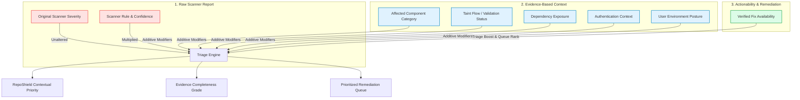

# RepoShield AI — Evidence-Based Vulnerability Prioritization Model

## Architectural Specification & Prioritization Framework

### 1. Objective & Core Epistemic Principles

Traditional Application Security (AppSec) tools suffer from alert fatigue because they rank findings solely by static scanner severity (e.g., classifying every SQL string interpolation or regex as "CRITICAL"), without accounting for runtime context, architectural exposure, or fix availability.

RepoShield AI implements an **Evidence-Based Contextual Vulnerability Prioritization Engine** that evaluates findings using concrete, observable code facts rather than severity labels alone.

> [!CAUTION]
> **Strict Truth-in-Evidence Guardrails:**
> 1. **No Invented Exploitability or Reachability:** Never synthesize runtime execution traces, ingress reachability, or network exposure without observable code or config evidence. If static analysis cannot trace an entrypoint route, reachability is recorded as `unproven`.
> 2. **Non-Probabilistic Ranking Guarantee:** The numerical priority score ($0.0 - 100.0$) is a deterministic triage ranking index. It is **never** presented as a validated mathematical probability of real-world exploitation or attack likelihood.
> 3. **Severe Finding Protection Floor (No Silent Downgrades):** Severe scanner findings (`CRITICAL`, `HIGH`) are **never** silently downgraded to `LOW` or `MEDIUM` merely because contextual information (such as call graphs or environmental parameters) is missing. If evidence is insufficient, that limitation is explicitly displayed, high triage visibility is preserved, and manual investigation is recommended.
> 4. **Affirmative Refutation Requirement:** Severe findings may only be downgraded when affirmative *refuting* evidence exists (e.g., test fixture confinement, confirmed false-positive validation, or dev-only dependencies).

---

## 2. Four Separated Evaluation Dimensions

RepoShield AI maintains strict separation between four distinct security dimensions:



| Evaluation Dimension | Description | Valid States |
| :--- | :--- | :--- |
| **1. Original Scanner Severity** | Raw, unmodified severity reported by the underlying scanner engine (Semgrep, Bandit, pip-audit). Preserved pristine for compliance and auditability. | `CRITICAL`, `HIGH`, `MEDIUM`, `LOW`, `INFORMATIONAL` |
| **2. RepoShield Contextual Priority** | Actionable urgency determined by combining scanner findings with observable architectural and environmental evidence. | `CRITICAL`, `HIGH`, `MEDIUM`, `LOW`, `INFORMATIONAL` |
| **3. Evidence Completeness** | Diagnostic grading of observable data points available to the engine. | `COMPLETE`, `PARTIAL`, `MINIMAL`, `INSUFFICIENT` |
| **4. Verification Status** | Dynamic lifecycle state of candidate security patches evaluated in isolated sandboxes. | `NOT_TESTED`, `RUNNING`, `VERIFIED_AGAINST_DEFINED_CHECKS`, `FAILED_VERIFICATION`, `INCONCLUSIVE` |

---

## 3. Mathematical Scoring Model & Contributing Factors

The priority score $S \in [0.0, 100.0]$ is calculated deterministically:

$$S_{\text{raw}} = (\text{BaseSeverity} \times \text{ConfidenceMultiplier}) + \sum_{i} \text{Modifier}_i$$

$$S = \text{clamp}\Big( \text{ApplyFloorProtection}(S_{\text{raw}}, \text{Severity}_{\text{scanner}}), \; 0.0, \; 100.0 \Big)$$

### Factor 1: Base Severity Baseline (CVSS v3.1 Qualitative Intervals)
* `CRITICAL`: **80.0**
* `HIGH`: **60.0**
* `MEDIUM`: **40.0**
* `LOW`: **20.0**
* `INFORMATIONAL`: **5.0**

### Factor 2: Scanner Confidence Multiplier
Discounts heuristic rules that exhibit high false-positive rates when confidence metrics are supplied:
* `HIGH` ($\text{score} \ge 0.85$): **1.00**
* `MEDIUM` ($0.50 \le \text{score} < 0.85$): **0.85**
* `LOW` ($\text{score} < 0.50$): **0.70**
* `UNSPECIFIED` (Confidence omitted by scanner): **1.00** *(Neutral baseline; scanners without confidence metrics are never penalized).*

### Factor 3: Additive Contextual Modifiers

| Contributing Factor | Observable Evidence Condition | Score Impact | Rationale |
| :--- | :--- | :---: | :--- |
| **Core Security Boundary** | File path or rule matches `auth/`, `login/`, `crypto/`, `iam/`, `tokens/`, or session management | **+10.0** | High-leverage architectural impact; compromise directly bypasses authentication or encryption. |
| **Public Ingress API** | File path resides in `routes/`, `controllers/`, `endpoints/`, `views/`, or public HTTP handlers | **+5.0** | Directly exposed to untrusted external client requests. |
| **Business Logic** | Resides in domain services, models, or core business rules | **0.0** | Neutral baseline. |
| **Internal Utility** | Resides in `utils/`, `helpers/`, `scripts/`, or internal CLI tooling | **-5.0** | Functions typically process sanitized internal data in non-serving contexts. |
| **Test Fixture Confinement** | File resides strictly in `tests/`, `test_*.py`, `mocks/`, `fixtures/`, or sample directories | **-20.0** | Confined strictly to test harnesses; cannot be executed in deployed production builds. |
| **Validated by Evidence** | `FindingValidation` assessment confirms observable sink or trigger condition (`SUPPORTED_BY_EVIDENCE`) | **+10.0** | Affirmative evidence confirms presence and elevates triage urgency. |
| **Possible False Positive** | `FindingValidation` provides concrete refuting evidence or demonstrates sanitization (`POSSIBLE_FALSE_POSITIVE`) | **-30.0** | De-prioritizes false alarms to prevent security alert fatigue. |
| **Verified Remediation Available** | Candidate patch proposal passed targeted regression and exploit verification (`VERIFIED_AGAINST_DEFINED_CHECKS`) | **+5.0** | Ready-to-merge, actionable resolution elevates remediation queue scheduling. |
| **Sensitive Data Involved** | Code excerpt or rule references credentials, API keys, tokens, or PII | **+10.0** | Compromise of secrets or PII incurs severe compliance and operational damage. |
| **Ingress Reachability** | Call graph or router mapping verifies external route entrypoint | **+10.0** | Code is demonstrably reachable via HTTP ingress. |
| **Unproven Reachability** | No call graph or execution trace evidence observed | **0.0** | Truth-in-evidence: reachability is never assumed or fabricated. |
| **Direct Production Dependency** | Vulnerable package directly declared in production runtime manifest (`requirements.txt`, `package.json`) | **+5.0** | Invoked directly by application code. |
| **Transitive / Dev Dependency** | Vulnerable package confined to secondary dev tooling or build requirements | **-10.0** | Excluded from deployed production artifacts. |
| **Unauthenticated Surface** | Endpoint confirmed accessible without valid credentials | **+10.0** | Any anonymous attacker can invoke the capability. |
| **Authenticated Admin / Internal** | Endpoint guarded by admin authorization or internal service perimeter | **-10.0** | Exploitation requires pre-existing privileged credentials or network access. |
| **Production Environment** | User-supplied environment tier: `production` | **+5.0** | Processes live customer and business data. |
| **Non-Production Environment** | User-supplied environment tier: `development` or `staging` | **-10.0** | Isolated sandbox without live data. |
| **Internet-Facing Deployment** | Asset directly exposed to public ingress | **+5.0** | Subject to automated reconnaissance and untargeted bot attacks. |
| **Internal Network Perimeter** | Asset isolated behind internal firewall / VPC | **-5.0** | Requires internal perimeter breach to access. |

---

## 4. Severe Finding Protection Floor (Handling Missing Information)

A central defect of naive scoring models is silently downgrading critical vulnerabilities because metadata (such as call graphs, user environments, or auth posture) is missing. RepoShield AI enforces the **Severe Finding Protection Floor**:

```python
has_affirmative_refutation = (
    affected_component == "test_or_mock_fixture"
    or reachability_status == "test_fixture"
    or finding_validation_status == "POSSIBLE_FALSE_POSITIVE"
    or dependency_exposure == "transitive_dev"
    or env_context.environment in ("development", "staging")
)

if not has_affirmative_refutation:
    if scanner_severity == "CRITICAL" and current_score < 60.0:
        current_score = 60.0  # Floor guarantees CRITICAL cannot drop below HIGH
        floor_protection_applied = True
    elif scanner_severity == "HIGH" and current_score < 40.0:
        current_score = 40.0  # Floor guarantees HIGH cannot drop below MEDIUM
        floor_protection_applied = True
```

### Explaining Limitations & Recommending Investigation
When evidence is incomplete:
1. `floor_protection_applied: true` is recorded in the assessment.
2. A transparent factor is added: `"Severe Finding Protection Floor: Preserving elevated triage priority because missing contextual evidence cannot justify silent downgrading."`
3. An explicit `investigation_recommendation` is generated:
   > *"Severe scanner finding (CRITICAL) preserved at HIGH priority. Because runtime reachability or environmental exposure is unproven, conduct dynamic exploit verification or call graph tracing before de-prioritizing."*

---

## 5. Priority Mapping Intervals

| Final Score Interval | RepoShield Contextual Priority | Triage Urgency & SLA |
| :---: | :---: | :--- |
| **$80.0 - 100.0$** | `CRITICAL` | **Immediate P0 Action:** Deploy verified patch or invoke incident remediation immediately. |
| **$60.0 - 79.9$** | `HIGH` | **Sprint Priority P1:** Prioritize remediation in current sprint; review proposed diffs. |
| **$40.0 - 59.9$** | `MEDIUM` | **Scheduled Triage P2:** Remediate within normal patch cycles; investigate reachability. |
| **$20.0 - 39.9$** | `LOW` | **Backlog P3:** Non-urgent; utility scripts, internal dependencies, or low confidence. |
| **$< 20.0$** | `INFORMATIONAL` | **Advisory P4:** Code quality or test fixture anomalies. |

---

## 6. Prioritized Remediation Queue & Recommendation Linkages

The Remediation Queue (`GET /api/v1/prioritization/remediation-queue`) orders findings by actionable triage priority:

1. **Primary Sort:** `priority_score` descending.
2. **Actionability Promotion:** Vulnerabilities with `VERIFIED_FIX_READY` status receive a $+10.0$ triage promotion because an engineering resolution is verified and ready for immediate deployment.

### Links From Recommendations to Supporting Findings
Every queue item includes a complete `RemediationLinkage` record linking:
* **Supporting Finding:** `finding_id`, `repo_name`, `file_path`, `line_number`, and code excerpt.
* **Candidate Patch Proposal:** `patch_proposal_id` and unified diff preview.
* **Verification Evidence:** `verification_run_id` and test results (`VERIFIED_AGAINST_DEFINED_CHECKS`).
* **AI Analysis Recommendations:** `analysis_id`, structured remediation instructions, and suggested targeted security tests.
